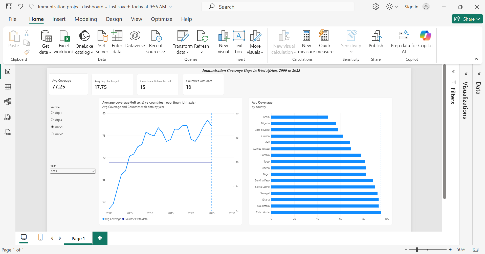
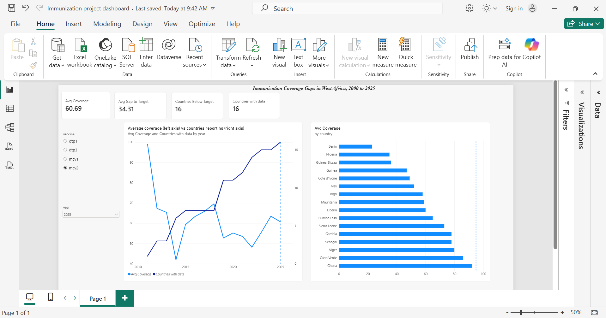
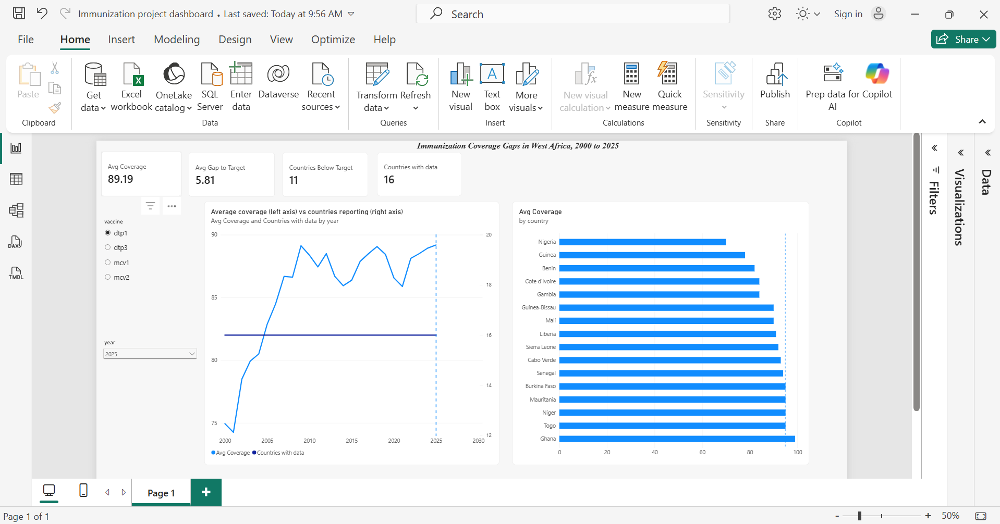
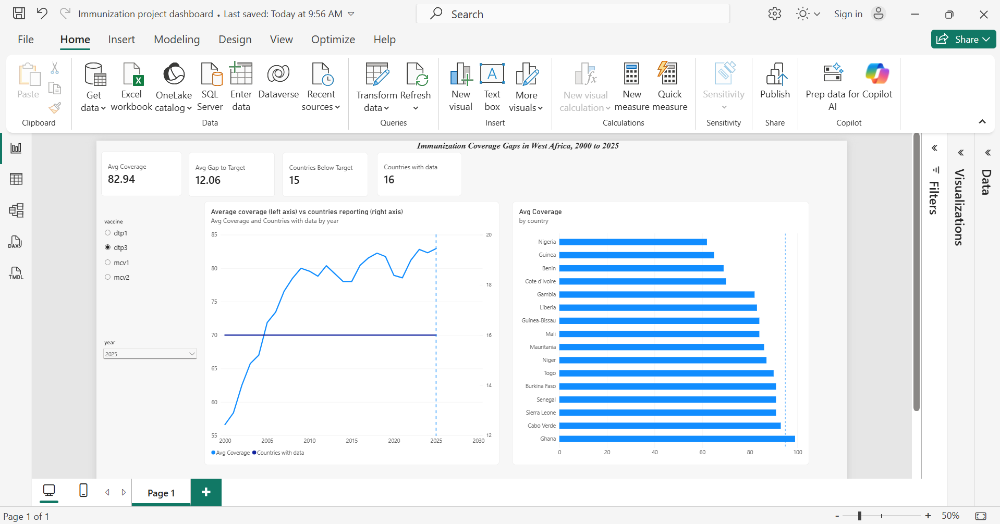

# Immunization Gaps in West Africa (DTP1, DTP3, MCV1, MCV2), 2000-2025

## Dashboard





MCV2 averages before about 2019 rest on very few countries (one country in 2011, three in 2012), so early swings in the MCV2 line reflect who is in the sample, not a real collapse in coverage.






**Question:** Which West African countries are furthest from the 95% coverage target for DTP and measles vaccines, and has the gap been closing since 2000?

**Short answer (from the data):** Progress has been real but uneven. The 16-country average MCV1 coverage rose from 58.4% (2000) to 77.2% (2025), yet 15 of 16 countries are still below 95%. Benin, Nigeria, Côte d'Ivoire and Guinea have the widest gaps, and four countries (Benin, Gambia, Côte d'Ivoire, Guinea-Bissau) are *lower* on MCV1 than in 2000.

## Data

- Source: UNICEF / WHO, *WUENIC estimates of national immunization coverage, 2025 revision*
  (https://data.unicef.org/resources/dataset/immunization/). Not redistributed in this repo: download the file and place it in `data/raw/`.
- Scope: 16 West African countries (BEN, BFA, CIV, CPV, GHA, GIN, GMB, GNB, LBR, MLI, MRT, NER, NGA, SEN, SLE, TGO), years 2000-2025, vaccines DTP1, DTP3, MCV1, MCV2.
- Grain: one row per country, vaccine and year.

## Method

| Stage | Tool | What it does |
|---|---|---|
| 1. Explore and prototype | Power Query (Power BI Desktop) | Selected 6 columns, filtered countries, vaccines and years, checked types and duplicates (`powerquery/wuenic_query.m`) |
| 2. Reproducible ETL | Python (pandas) | Same recipe in code, quality checks, gap metrics, CSV output (`python/02_transform.py`) |
| 3. Warehouse and analysis | SQL Server | Table with a country-year primary key, gap, ranking and trend queries (`sql/`) |
| 4. Dashboard | Power BI | Data model, DAX measures, slicers (`powerbi/`) |

### Metric definitions

- **Gap to 95** = 95 - coverage. Positive means below the target.
- **Zero-dose %** = 100 - DTP1 coverage (children who did not receive even one DTP dose).
- **DTP dropout %** = (DTP1 - DTP3) / DTP1 x 100 (children who started but did not finish).
- **MCV1 to MCV2 drop** = MCV1 - MCV2, indicative only.

### Data quality checks (all enforced in `02_transform.py`)

16 countries present, no nulls in the long table, no duplicate country/vaccine/year rows, coverage between 0 and 100, 1,383 rows after filtering.

## Key findings (2025 unless stated)

- Furthest from the 95% MCV1 target: Benin (49%), Nigeria (56%), Côte d'Ivoire (58%), Guinea (62%).
- Largest zero-dose share (DTP1 gap): Nigeria (30%), Guinea (22%), Benin (18%).
- Highest DTP1 to DTP3 dropout: Côte d'Ivoire and Guinea (16.7%), Benin (15.9%).
- Biggest MCV1 gains since 2000: Sierra Leone (+53 points), Mauritania (+47), Niger (+45). Nigeria had the lowest MCV1 in 2000 (33%).
- MCV2 is the weakest vaccine: Benin 23%, Nigeria 35%, Guinea-Bissau 36% in 2025.

## Caveats

- MCV1, DTP1 and DTP3 coverage use *surviving infants* as the denominator; MCV2 uses children at the age of the second dose (`y02`). The two measles figures are therefore not a strict like-for-like comparison.
- MCV2 was introduced in different years by different countries (Benin has a single value, in 2025), so MCV2 series are short and uneven.
- Regional averages are simple means of the 16 countries, not population-weighted.
- WUENIC estimates are revised each year; figures may change in later revisions.

The 95% benchmark is the measles herd immunity threshold, applied here as a single yardstick across all four vaccines. The Immunization Agenda 2030 target for DTP3 is 90%, so DTP gaps shown here are stricter than the official target.

## How to run

```powershell
python -m venv .venv
.venv\Scripts\Activate.ps1
pip install -r requirements.txt
python python/02_transform.py
```

Then run `sql/01_create_and_load.sql` and `sql/02_analysis.sql` in SSMS, and open `powerbi/` in Power BI Desktop.

## Repository layout

```
data/raw/          original UNICEF file (not committed)
data/processed/    clean CSVs produced by Python
powerquery/        Power Query (M) recipe
python/            ETL scripts
sql/               table creation and analysis queries
powerbi/           dashboard (.pbix) and DAX measures
```
